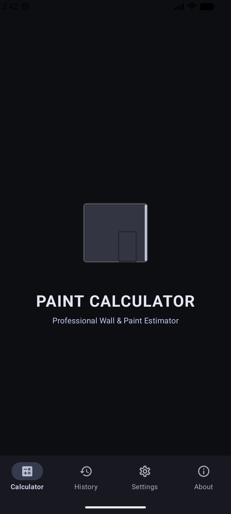
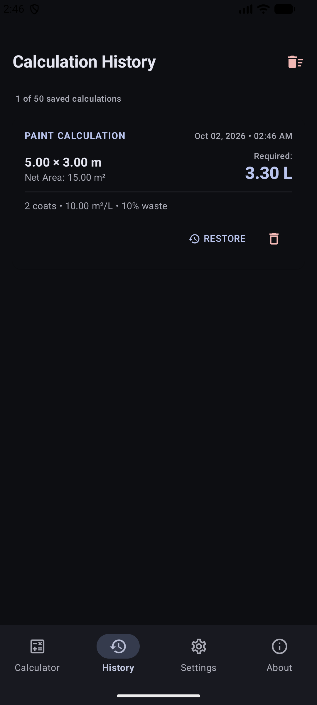
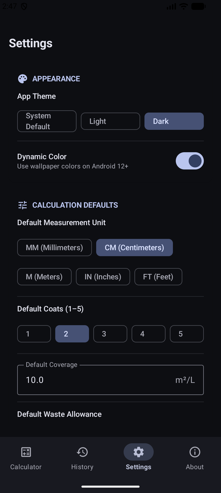
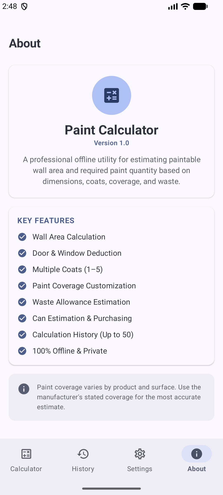
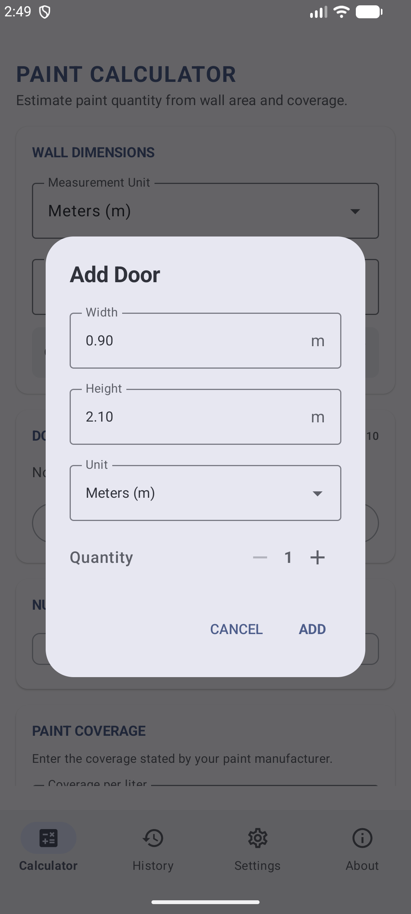
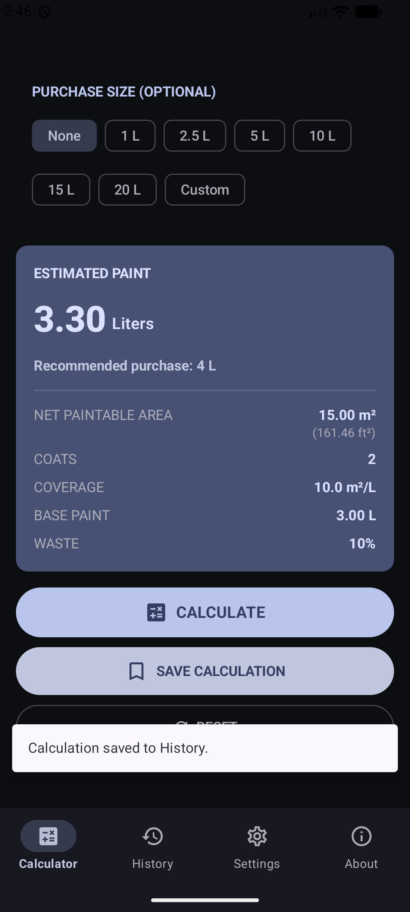
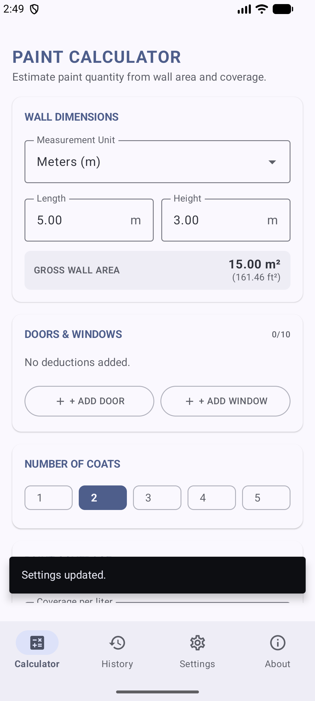

# BrushBudget 🎨🖌️

**BrushBudget** is a modern, intuitive, and professional Android paint calculation utility built with **100% Kotlin**, **Jetpack Compose**, and **Material 3**. Designed for painters, interior designers, contractors, and DIY enthusiasts, BrushBudget makes estimating paint volume, surface coverage, wall opening deductions, waste allowances, and required paint cans fast, precise, and effortless.

---

## 🌟 Key Features

- **📐 Precise Surface Area Calculation**: Calculate gross wall area instantly by entering wall length and height in meters or feet.
- **🚪 Opening Deductions**: Easily subtract non-paintable surfaces such as doors, windows, and custom openings with quantity multipliers.
- **🖌️ Coat & Coverage Customization**: Support for 1 to 5 paint coats and custom coverage rates ($m^2/\text{L}$ or $ft^2/\text{gal}$).
- **♻️ Waste Percentage Allowance**: Account for paint absorption, roller waste, and spills with configurable waste margins (0% – 100%).
- **🛢️ Paint Can Estimator**: Select standard container sizes (1L, 2.5L, 5L, 10L, 20L) or enter a custom size to determine the exact number of cans to purchase and calculate leftover paint.
- **📜 Calculation History**: Save up to 50 past estimates locally with timestamps and reload any saved calculation directly back into the engine.
- **⚙️ Custom Preferences**: Configurable app defaults (default measurement units, coverage, coats, waste, theme modes, haptics, and sound effects) powered by Jetpack DataStore.
- **🌓 Material 3 Theming**: Supports Light Mode, Dark Mode, Dynamic Color, and Material You design guidelines.
- **🔒 Private & Offline**: Works entirely offline with zero data tracking or external network requests.

---

## 📱 Screenshots

| Main Calculator | History Log | Settings & Defaults | About Page |
| :---: | :---: | :---: | :---: |
|  |  |  |  |

| Add Opening Dialog | Saved Calculation | Light Theme |
| :---: | :---: | :---: |
|  |  |  |

---

## 🧮 Mathematical Formula & Calculation Engine

BrushBudget uses a robust calculation engine (`PaintCalculatorEngine.kt`):

1. **Gross Wall Area**:
   $$\text{Gross Area} = \text{Wall Length} \times \text{Wall Height}$$
2. **Total Opening Deduction**:
   $$\text{Opening Area} = \sum (\text{Opening Width} \times \text{Opening Height} \times \text{Quantity})$$
3. **Net Paintable Area**:
   $$\text{Net Area} = \max(0, \text{Gross Area} - \text{Opening Area})$$
4. **Total Surface Coverage Needed**:
   $$\text{Total Coat Area} = \text{Net Area} \times \text{Coats}$$
5. **Base Paint Requirement**:
   $$\text{Base Paint (Liters)} = \frac{\text{Total Coat Area}}{\text{Coverage Rate ($m^2$/L)}}$$
6. **Total Paint Needed (With Waste)**:
   $$\text{Required Paint (Liters)} = \text{Base Paint} \times \left(1 + \frac{\text{Waste \%}}{100}\right)$$
7. **Can Quantity & Leftover**:
   $$\text{Can Count} = \left\lceil \frac{\text{Required Paint}}{\text{Can Size}} \right\rceil$$
   $$\text{Leftover Paint} = (\text{Can Count} \times \text{Can Size}) - \text{Required Paint}$$

---

## 🛠️ Tech Stack & Architecture

- **Language**: [Kotlin](https://kotlinlang.org/) (100%)
- **UI Framework**: [Jetpack Compose](https://developer.android.com/jetpack/compose) with [Material 3](https://m3.material.io/)
- **Architecture**: MVVM (Model-View-ViewModel) + Unidirectional Data Flow (UDF)
- **Async & Reactive**: Kotlin Coroutines & `StateFlow` / `SharedFlow`
- **Navigation**: Jetpack Navigation Compose
- **Data Persistence**: Jetpack DataStore Preferences & JSON Serialization
- **Design System**: Material Design 3, Dynamic Color support
- **Testing**: JUnit 4 for unit test coverage on engine and conversion utilities

---

## 📂 Project Structure

```text
com.example.paintcalculator/
├── data/
│   └── PreferencesManager.kt       # Datastore management & history persistence
├── model/
│   ├── AppSettings.kt              # App configuration model
│   ├── CalculationRecord.kt        # History record data structure
│   ├── MeasurementUnit.kt          # Meters / Feet enum & label provider
│   ├── OpeningType.kt              # Door, Window, Custom enum
│   ├── PaintCalculationInput.kt    # Input params for engine
│   ├── PaintCalculationResult.kt   # Engine output model
│   └── PaintOpening.kt             # Individual opening item model
├── ui/
│   ├── navigation/
│   │   ├── AppNavigation.kt        # NavHost and bottom bar navigation
│   │   └── Screen.kt               # Route definitions
│   ├── screens/
│   │   ├── about/AboutScreen.kt    # About page & feature list
│   │   ├── calculator/             # Main calculator & opening dialog
│   │   ├── history/HistoryScreen.kt# Saved calculations history list
│   │   ├── settings/SettingsScreen.kt # App preferences & default settings
│   │   └── SplashScreen.kt         # Animated splash screen
│   ├── theme/                      # Material 3 colors, typography, theme setup
│   └── viewmodel/                  # PaintCalculatorViewModel & UI state
└── util/
    ├── PaintCalculatorEngine.kt    # Core calculation logic & validation
    ├── SoundAndHapticHelper.kt     # Haptic & audio feedback integration
    └── UnitConverter.kt            # Unit transformation utilities (m, ft, sq meters, sq feet)
```

---

## 🚀 Getting Started

### Prerequisites

- **Android Studio**: Ladybug (2024.2) or higher recommended
- **JDK**: Java 11 or higher
- **Android SDK**: Minimum API Level 24 (Android 7.0), Target API Level 35/37

### Installation & Build

1. **Clone the repository**:
   ```bash
   git clone https://github.com/abdullah-ateeq/BrushBudget.git
   cd BrushBudget
   ```

2. **Open in Android Studio**:
   Open Android Studio, choose **Open**, and select the project directory.

3. **Build the Debug APK**:
   ```bash
   ./gradlew assembleDebug
   ```

4. **Run Unit Tests**:
   ```bash
   ./gradlew test
   ```

---

## 🧪 Testing

The core calculation engine and unit converters are verified by extensive unit tests (`PaintCalculatorUnitTest.kt`):
- Area calculation tests (gross, openings, net)
- Metric and imperial conversions
- Waste percentage and coat scaling
- Can size estimation edge cases
- Validation logic rules

Run test suite via Gradle:
```bash
./gradlew :app:testDebugUnitTest
```

---

## 📄 License

```text
Copyright 2025 Abdullah Ateeq

Licensed under the Apache License, Version 2.0 (the "License");
you may not use this file except in compliance with the License.
You may obtain a copy of the License at

    http://www.apache.org/licenses/LICENSE-2.0

Unless required by applicable law or agreed to in writing, software
distributed under the License is distributed on an "AS IS" BASIS,
WITHOUT WARRANTIES OR CONDITIONS OF ANY KIND, warmth or fitness for a particular purpose.
See the License for the specific language governing permissions and
limitations under the License.
```

---

<p align="center">
  Crafted with ❤️ using Jetpack Compose
</p>
